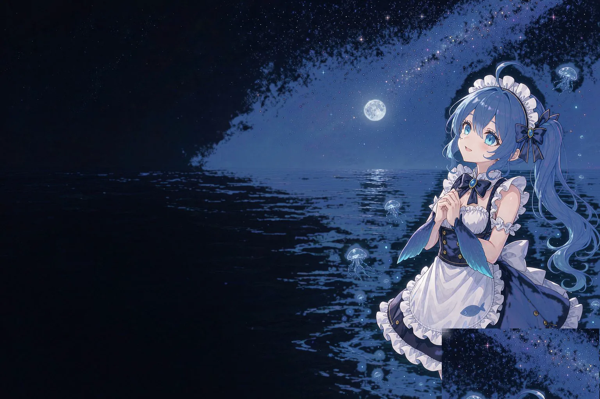

<div align="center">


# dsh-lumen

**流转壁纸 · 给 DeepSeek Harness 的壁纸调度器**

<sub>1 套程序化生成的晨雾壁纸 &nbsp;·&nbsp; 4 张随包插画 &nbsp;·&nbsp; 本地图片 / 图片地址<br>按间隔 · 整点 · 每日 · 每次会话自动换图，带交叉淡入<br>输入框有蓝环，左边挂一只鲸鱼娘，点她能收成一条尾巴<br>另有随包开屏短片：装好即默认启用，可换成自己的素材，也可以直接关掉</sub>

[](package.json)
[](LICENSE)
[](package.json)
[](tests)
[](https://github.com/lhr040306/dsh-lumen)

[开屏](#开屏) &nbsp;·&nbsp; [消息栏](#消息栏) &nbsp;·&nbsp; [壁纸](#壁纸一览) &nbsp;·&nbsp; [不同之处](#它和常见的换肤插件有什么不同) &nbsp;·&nbsp; [功能](#功能速览) &nbsp;·&nbsp; [安装](#安装) &nbsp;·&nbsp; [文档](#文档索引)

</div>

---

> 它想回答的不是"换一张好看的图"，而是两个具体问题：**现在显示什么**，以及**下一次什么时候变、变成什么**。
>
> 壁纸分两类。一套**参数化配方**在运行时用 CSS 渐变算出来，没有图片素材，换种子就是同一种风格的另一种构图；四张**插画**随包内置（约 1.1 MB），由宿主半边按形状白名单从包内送出。装好第一眼是那张「黄昏」。

---

## 开屏

<div align="center">

<a href="media/splash.mp4"></a>

<sub>5 秒 · 0.7 MB · 随包内置，装好就播 &nbsp;—&nbsp; 点封面播放</sub>

</div>

一段短片，四个出口全部有界：首帧 8 秒、总寿命 120 秒、解码失败、用户跳过。它**不出网，也不写盘**——字节就在包里，由宿主经本机路由直接读出播放，两份拷贝都不产生。

一个素材可以有两处去处：**设为壁纸**、**设为开屏**、或者两个都要。想换回内置那段、或者彻底关掉，各是一个按钮，不是一句"留空即默认"。

图片开屏走纯 CSS，随文档一起送达，所以它在**第一帧**就上色，不会先黑一下再淡入。

---

## 消息栏

输入框是洗色层唯一没有盖住的那整块表面，所以它得到的是**两笔**，不是一张图。

**一笔是环。** 四边一圈 2.5px 的蓝色渐变细环，静止时 75% 不透明度，鼠标移上去或光标落进框里时全亮。渐变从左上角走到右下角，故意不均匀 —— 两端亮、长边中间暗下去，看起来像光打在边上，而不是描了一道边。这个"不均匀"只有在 2.5px 时才需要调：细到 1.5px，人眼会自动补齐中间那段；2.5px 就会露出断口。

**另一笔是她。** 左边挂着鲸鱼娘，手指勾在框的左边线上，**点她一下收成一条尾巴，再点一下回来**。光标落进输入框时她往外探 4px，只在真正开始打字的那一刻发生一次。

她是一个伪元素，不是节点：输入框归 React 管，往卡片里塞的东西下一次渲染就没了；点她靠几何命中测试加捕获阶段拦截，所以点她**不会顺手把焦点送进输入框**。

面板里一个开关就能把这些全关掉，而且关得干净 —— 环和鲸鱼娘是 `content:none`，**根本不生成**，不是藏起来；关掉之后输入框与 DSH 原样一致。窄窗口下她的尾巴会被输入框所在那一列的边缘裁掉一节：那里没有可供测量的空间，所以宁可裁掉，也不换位置。

---

## 壁纸一览

<table>
  <tr>
    <td align="center" width="50%">
      <a href="media/wallpapers/whale-sunset.webp"></a><br>
      <b>黄昏</b> &nbsp;Dusk &nbsp;<code>whale-sunset</code><br>
      <sub>楼顶、落日与城市天际线 &nbsp;—&nbsp; <b>首次安装看到的就是这张</b></sub>
    </td>
    <td align="center" width="50%">
      <a href="media/wallpapers/whale-starlit.webp"></a><br>
      <b>星海</b> &nbsp;Starlit &nbsp;<code>whale-starlit</code><br>
      <sub>月夜海面，水母悬在暗处</sub>
    </td>
  </tr>
  <tr>
    <td align="center" width="50%">
      <a href="media/wallpapers/whale-point-half.webp"></a><br>
      <b>夜潮</b> &nbsp;Night Tide &nbsp;<code>whale-point-half</code><br>
      <sub>深蓝海面上的回头一指，最"潮水"的一张</sub>
    </td>
    <td align="center" width="50%">
      <a href="media/wallpapers/whale-point-full.webp"></a><br>
      <b>深蓝</b> &nbsp;Deep Blue &nbsp;<code>whale-point-full</code><br>
      <sub>最安静的一张，几乎只剩蓝和一点点星光</sub>
    </td>
  </tr>
</table>

另外一套**没有缩略图**，因为它不是图片文件 —— `mist`（晨雾）在运行时由参数算出 CSS 渐变，换个种子就是另一种构图，面板上那个「摇一摇」只对它有效。

| id | 名称 | 取向 | complexity | 类型 |
| :-- | :-- | :--: | :--: | :-- |
| `mist` | 晨雾 · Mist | 浅 | 0.20 | 生成式，可摇种子 |
| `whale-point-half` | 夜潮 · Night Tide | 深 | 0.55 | 随包插画 |
| `whale-starlit` | 星海 · Starlit | 深 | 0.50 | 随包插画 |
| `whale-sunset` | 黄昏 · Dusk | 深 | 0.60 | 随包插画（**默认**） |
| `whale-point-full` | 深蓝 · Deep Blue | 深 | 0.55 | 随包插画 |

`complexity` 是"画面有多花"的估计值（0–1），驱动自动弱化；插画的亮度是在图片文件上**实测**出来的，同样喂给可读性下限。

<details>
<summary>旧版本里被退役的三套去哪了</summary>

`aurora`（极光）、`starfield`（星野）、`dune`（沙丘）与 `drift`（弥散）已经不在了。如果它们还留在你的状态文件或播放列表里，会按**意图**就地改写 —— 极光 → 晨雾、星野 → 星海、沙丘 → 晨雾、弥散 → 晨雾，而不是几条一起塌到同一张。

</details>

---

## 它和常见的换肤插件有什么不同

| | 常见做法 | dsh-lumen |
| :-- | :-- | :-- |
| **壁纸从哪来** | 打包一堆图片，或让用户自己传 | 两套**参数化配方**算出来，可选集不随体积增长；另外四张插画随包内置，取舍见[壁纸规格](docs/WALLPAPER-SPEC.md) |
| **什么时候换** | 装上就一直是一张 | **调度器**：4 种触发方式 × 3 种顺序策略，落在可预测的钟点上 |
| **文字还看得清吗** | 交给用户自己调透明度 | 洗色层透明度对着 **WCAG AA 对比度求解**，且永远不比用户设的更透明 |

一句话：它是一个**壁纸调度器**，壁纸的生成方式只是它的素材来源之一。

---

## 功能速览

| 模块 | 内容 |
| :-- | :-- |
| **壁纸来源** | 1 套内置配方（晨雾，浅）· 4 张内置插画 · 本地图片（可多选、可拖拽）· 图片地址 |
| **轮播调度器** | 4 种触发方式 × 3 种顺序策略 · 间隔模式**锚定网格**，不随刷新重置 · 洗牌走完一轮前不重复 · 有损追赶 |
| **开屏** | **内置短片默认开启** · 一个素材两处去处 · 图片开屏走纯 CSS **首帧上色** · 视频静音自动播放 · 四个出口全部有界 |
| **消息栏** | **2.5px 蓝环**（静止 75%，hover / 聚焦全亮）· 左边一只鲸鱼娘，点她收成尾巴 · 一个开关回到 DSH 原样 · 尊重 `prefers-reduced-motion` |
| **可读性下限** | alpha 对着 WCAG 2.1 AA 求解 · 副文本（时间戳 / 用量 / 图标）按各自的阈值**加深** · 面板**显示实际生效值**而非偷偷改掉 · 本地图片**实测亮度**驱动 |
| **工程** | 中英双语 170 条键完全对称 · 两层持久化跨重启生效 · 插件入口**从不抛异常** · 391 项单元测试 |
| **面板** | 四段：壁纸 / 开屏 / 消息栏 / 运行状态 · 轮播调度与外观折进壁纸下的「更多设置」· 壁纸段常开，因为它就是"现在显示什么" |

<details>
<summary>展开每一项的细节</summary>

**壁纸来源**

- 1 套内置配方（晨雾），由参数实时生成，无图片素材；可换种子，同一风格的另一种构图
- 4 张内置插画（夜潮 / 星海 / 黄昏 / 深蓝），随包附带，装好即用；插画没有种子，所以面板上不给它「摇一摇」
- 本地图片：**可多选，也可直接把文件拖到那一行**；等比缩放压缩后本地保存，原图不上传
- 图片地址（仅 `http` / `https`）

**轮播调度器**

- 4 种触发方式：`按间隔` / `整点` / `每日` / `每次会话`；3 种顺序策略：`顺序` / `洗牌` / `随机`
- 间隔模式**锚定网格**，不随刷新页面重置；洗牌模式走完一轮之前不重复
- 显示"下一次更换"的倒计时与后续 5 个触发时刻；可随时暂停 / 继续
- **有损追赶**：睡过五个触发点只换一次，不在用户眼前闪五张图

**消息栏**

- 环是用 `mask-composite` 画出来的，不是 `border`：`border` 会把输入的文字挤进去，`outline` 吃不了渐变。整条规则包在 `@supports` 里 —— 画不了遮罩合成的引擎会把它涂满整张卡，那比没有框更糟
- 聚焦时的阴影是有意换掉的：`box-shadow` 只能整体覆盖、不能追加，而宿主那套是一次 token 查询，重推一遍不是这张样式表该做的事。所以给它一个专用的 3px 柔和蓝环加稍深的投影，卡片"亮起来"的同时也"抬起来"
- 鲸鱼娘走的是插画那条本机路由（`media/wallpapers/` 目录即白名单），不打进浏览器包；她不在壁纸库里，所以永远不会出现在面板或播放列表
- 折叠和开关都是 `<html>` 上的一个属性，而不是往 React 的卡片上写东西 —— 卡片每次重渲染都会把写进去的节点抹掉
- 窄窗口的代价是明写的：卡片上限 952px 且居中，宽窗口两侧有几百像素，窄窗口只剩 16px 的边距，贴图尾巴会被列边缘裁掉一节

**可读性下限**

- 洗色层 alpha 对着 **WCAG 2.1 AA（4.5:1）** 求解，实际生效值取"用户设定"与"求解最小值"中较大者
- **副文本单独救**：`secondary` / `tertiary` 这两条弱化色主题本身就压在 AA 之下（tertiary 对纯白只有 3.7:1），加厚遮罩最多逼近 3.7 而到不了 4.5 —— 天花板是颜色本身能给到的。所以改为**只沿 Oklab 亮度把颜色往背离背景的方向移动**，刚好够读就停
- 两条弱化色各有各的靶子：`secondary` 仍按正文的 4.5，`tertiary` 按 **3.0**（WCAG AA 对大字与非文本的阈值，正是 11–13px 元信息该对的那根线）。移动预算给到 0.10 相对亮度，够不到就先吃到预算为止 —— 把弱化层级压平是另一种缺陷
- 落点吸附在 5/255 的网格上、且只往背离背景的方向取整，所以拖动"壁纸可见度"时文字不会一点点地闪
- 面板**把差异显示出来**，而不是偷偷改掉；最近一次的求解结果挂在 `window.__DSH_LUMEN__.engine.quietLabels`（`from` / `to` / `ratio` / `target` / `capped`）—— "还是有点淡"有两个成因，屏幕上长得一模一样：本来就不用动，或者预算用完了
- 本地图片在导入时**实测亮度**（取上四分位，非平均值），四张内置插画在随包前就测好了，两者都用来驱动下限 —— 而不是套一个常数

**面板与工程**

- 设置面板四段：壁纸 / 开屏 / 消息栏 / 运行状态；轮播调度与外观折进壁纸下的「更多设置」—— 它们被改一次就不再进，不该常年占着版面。壁纸段常开，因为它回答的就是"现在显示什么"
- 中英双语，两套字典各 170 条键、完全对称
- 持久化跨 DSH 重启生效（宿主侧权威副本 + `localStorage` 快速种子）
- 插件入口**从不抛异常**——最坏情况是"壁纸不出现 + 控制台一行日志"，不会让 DSH 起不来
- 调度部分是纯函数，睡过触发点、时钟回拨、夏令时、两张图的洗牌列表这类边界都能当普通单测来测

</details>

---

## 安装

前置：**DSH Desktop 或 DSH Web**，Node ≥ 18。

`package.json` 就在仓库根上，所以下面两种来源都能直接装。

**方式一 · GitHub 地址**（推荐）。在 DSH 的插件安装入口（**设置 → 插件 → 安装**）里填：

```text
https://github.com/lhr040306/dsh-lumen
```

**方式二 · 本地目录**。先 `git clone` 到一个不会随手删掉的位置，安装入口填**仓库根目录的绝对路径**。

CLI 等价写法：

```sh
dsh plugin --profile web add github:lhr040306/dsh-lumen
```

要钉住版本，就在地址后面加标签或 commit（`#v1.3.2`，或任意 commit sha）。装完**重启 DSH**，然后打开 **设置 → 壁纸**。

> [!WARNING]
> 桌面端的 `desktop` profile 由 Electron 应用独占管理，CLI 会硬拒 —— 桌面端请走客户端自带的插件管理入口。
>
> 插件还没发布到 npm，别在安装入口填 `dsh-lumen`：那会被当成 npm 包名去查仓库，查不到就报「未找到相关插件」。GitHub 地址与本地目录也**不经过安装源（镜像源）**，装不通时先确认这台机器能访问 `github.com`。

安装、更新、卸载、验证和故障排查都写在 [`docs/INSTALL.md`](docs/INSTALL.md) —— 包括"壁纸不出现、控制台只有一行日志"这种情况该对照哪张表。

---

## 文档索引

| 文档 | 内容 |
| :-- | :-- |
| [`docs/PACKAGE.md`](docs/PACKAGE.md) | 包的完整说明：功能、内置壁纸、调度器、可读性下限、持久化、隐私与安全、兼容性 |
| [`docs/INSTALL.md`](docs/INSTALL.md) | 安装、更新、卸载、验证、故障排查 |
| [`docs/INNOVATION.md`](docs/INNOVATION.md) | 在哪些地方做了不同的技术选择，以及为什么 |
| [`docs/WALLPAPER-SPEC.md`](docs/WALLPAPER-SPEC.md) | 配方参数、状态字段、调度常量、存储格式的完整规格 |
| [`docs/SPLASH-SPEC.md`](docs/SPLASH-SPEC.md) | 开屏协议：媒体存储、四条路由、内置短片、启动遮罩与兜底守卫 |

---

## 隐私与安全

<details>
<summary>展开</summary>

- **插件自身不发任何网络请求。** 两套生成式壁纸由参数实时算出；四张内置插画由宿主从包内读出、经本机路由 `/lumen/wallpaper` 送出，不出网也不解压到别处；`图片地址` 由浏览器直接加载，插件不代理、不上报、不探测可达性。
- **壁纸不读磁盘。** 本地图片走浏览器 `File` API 读入（点选和拖拽同一条路径），缩放压缩后存本地，原图不会被复制到别处。
- **开屏会写自己的媒体目录。** 媒体字节落在 `$DSH_HOME/lumen-media/`，**文件名由宿主生成**，状态里只留文件名——既不是路径，也不是字节。
- **内置开屏不出网、不写盘。** 那段短片就在包里，由宿主直接读出、经本机路由 `/lumen/splash/media` 播放，两份拷贝都不产生；状态里只有一个来源标记。
- **宿主路由是围栏，不是鉴权。** `/lumen/api`、`/lumen/splash` 与 `/lumen/wallpaper` 走同一道围栏，要求回环地址的 `Host` + 同源浏览器标记（DNS rebinding / 跨站防御），并叠加宿主提供的会话鉴权层。
- **重名也不冲突。** 所有 DOM 节点带 `data-dsh-lumen` 标记，样式表 id 为 `dsh-lumen-style`，存储键前缀 `dsh-lumen:`。

</details>

---

## 兼容性

- 在 DSH Desktop 0.2.0-rc.2、Node 24.21.0 上实测通过
- `engines.node >= 18`；运行时**不依赖任何第三方包**（`react` 走宿主模块表，取不到时只跳过设置面板，壁纸照常工作）

---

## 许可

MIT，见 [`LICENSE`](LICENSE)。

本项目是**第三方插件，非 DeepSeek 官方产品**，遵循 DSH 社区的插件惯例。
